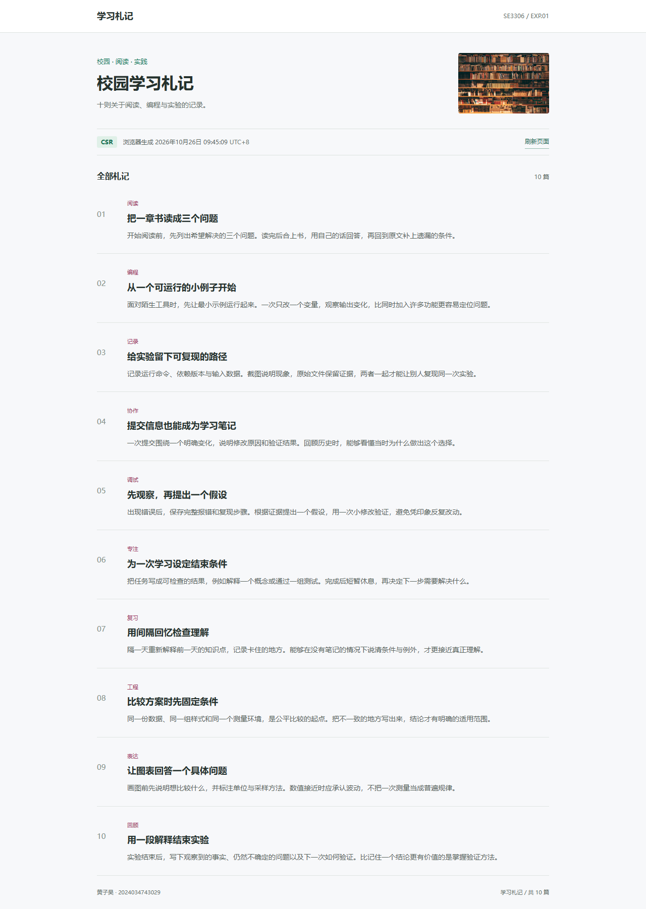
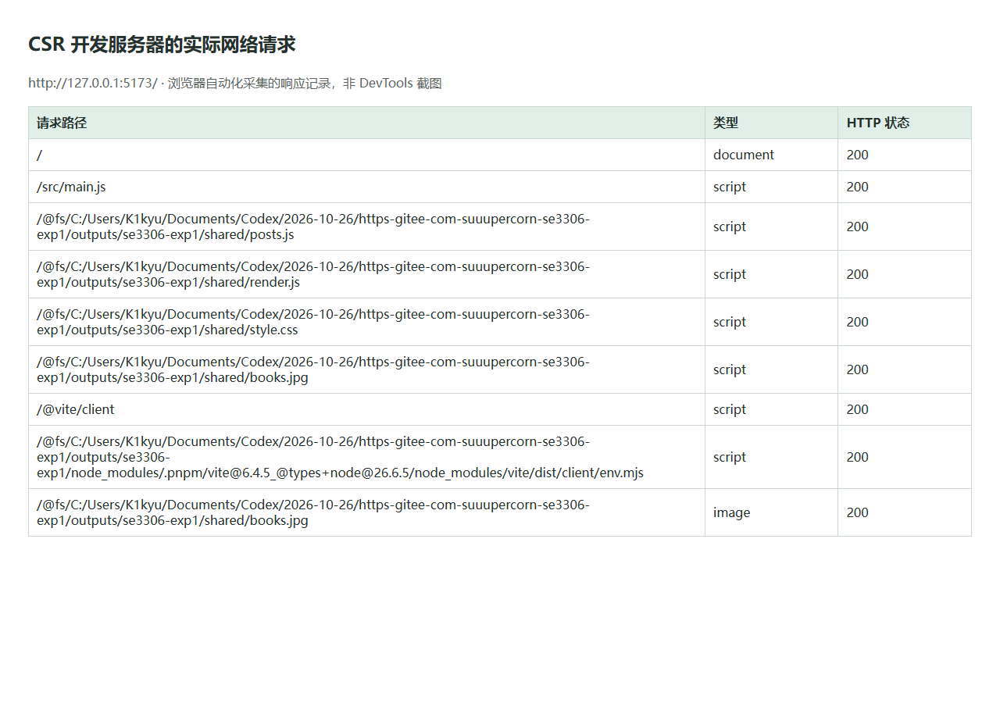
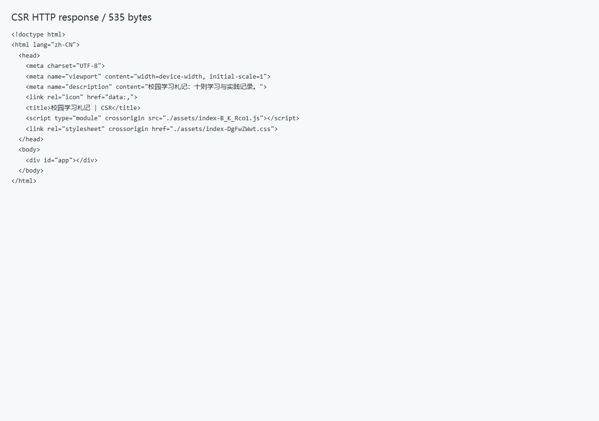
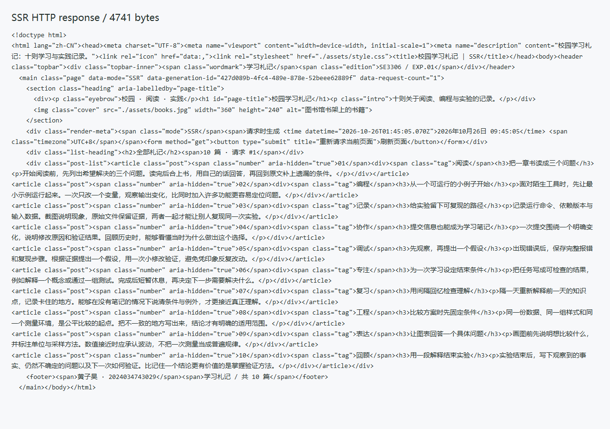
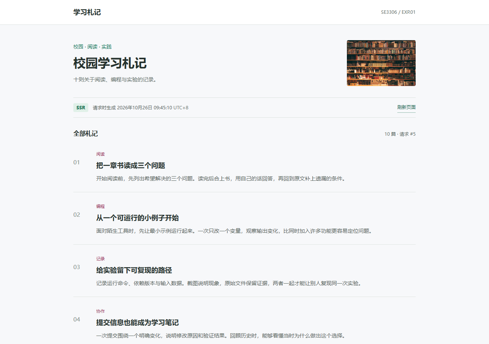
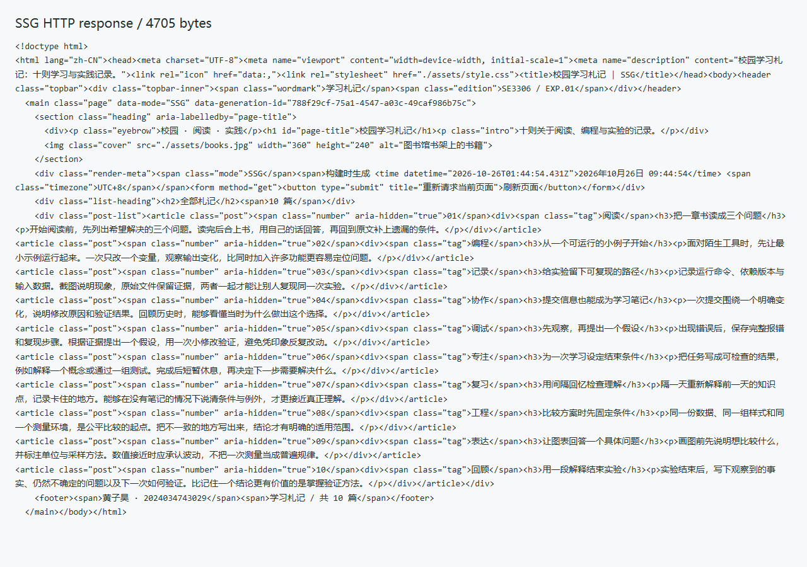
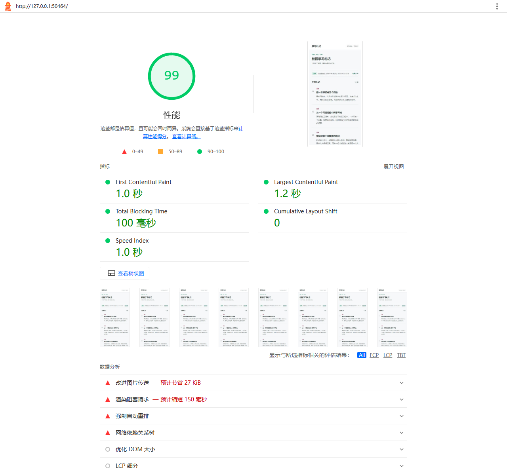
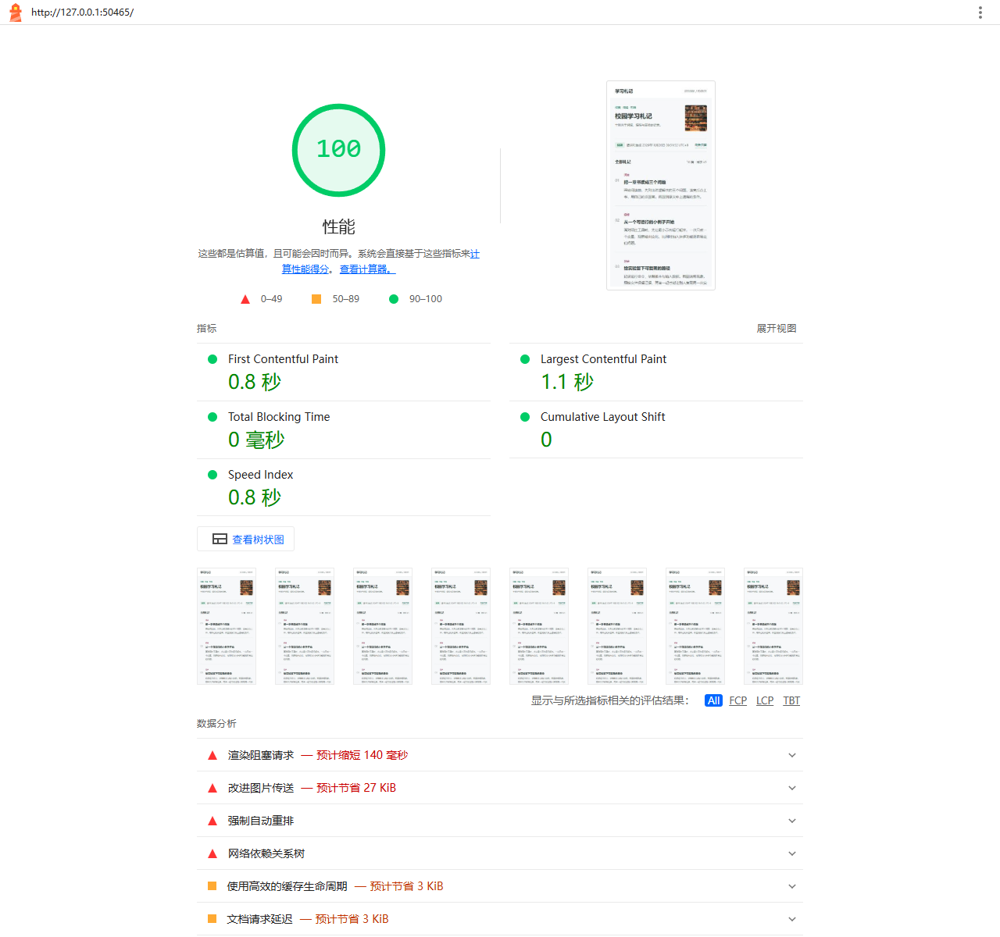
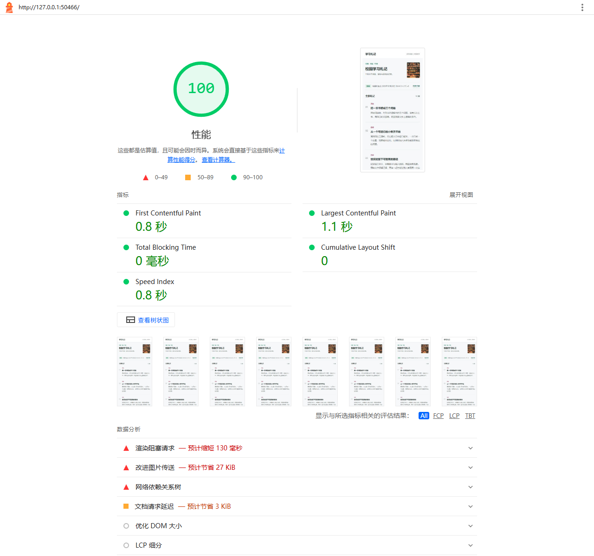

# 实验一 CSR SSR SSG 渲染对比

| 项目 | 内容 |
| --- | --- |
| 姓名 | 黄子昊 |
| 学号 | 2024034743029 |
| 班级 | 软件工程1班 |
| 实验日期 | 2026-10-26 |
| 页面主题 | 校园学习札记 |
| 技术栈 | 原生 JavaScript、Vite 6、Express 4、Node.js |
| 项目仓库 | https://gitee.com/k1kyu/se3306-exp1 |
| CSR 在线页面 | [打开 CSR](https://k1kyu-exp1-csr.onrender.com/) |
| SSR 在线页面 | [打开 SSR](https://k1kyu-exp1-ssr.onrender.com/) |
| SSG 在线页面 | [打开 SSG](https://k1kyu-exp1-ssg.onrender.com/) |
| 当前范围 | 本地实现、测量、报告、仓库提交与三个页面的免费云端部署 |

三个页面均已部署到 Render。CSR 和 SSG 使用静态托管，SSR 使用免费 Node 服务；SSR 闲置 15 分钟后会休眠，再次访问可能等待约一分钟。部署配置与线上核验见 [线上部署](docs/线上部署.md)。

本实验用相同的十篇文章、同一套样式和同一张本地图片，对比浏览器运行时、服务端请求时、构建时生成 HTML 的差别。主要证据是原始 HTTP 响应、禁用 JavaScript 后的页面、数据更新前后的响应和本机性能报告。

本实验中，本人补充原始任务书、提出独立实现要求并确认工作范围，使用 Codex 辅助完成代码实现、自动化测量和报告起草。具体分工与证据来源见 [AI 使用声明](AI%20使用声明.md)，实验体会见第十一节。实验要求以原始任务书为依据，逐项核对见 [要求核对](docs/要求核对.md)。

## 一 实验目的

1. 确认三种模式分别在什么位置、什么时间生成正文。
2. 用 HTML 大小、FCP、LCP 和源码正文可见性进行比较。
3. 区分首屏生成方式、后续交互方式和数据更新方式。
4. 根据数据更新频率、个性化与首屏需求选择方案。

## 二 环境与运行

| 工具 | 本次使用 |
| --- | --- |
| 操作系统 | Windows，系统构建 10.0.26200，x64 |
| 处理器与内存 | Intel Core i7-14650HX，16 GB |
| Node.js | 24.14.1 |
| pnpm | 11.25.0 |
| Vite | 6.4.5 |
| Express | 4.22.3 |
| Chrome | 156.0.8078.47 |
| Playwright / Lighthouse | 1.64.1 / 13.5.0 |

在项目根目录执行，每行是一个命令：

```powershell
pnpm install --frozen-lockfile
pnpm build
pnpm start
```

默认打开 CSR `http://127.0.0.1:4173/`、SSR `http://127.0.0.1:3000/`、SSG `http://127.0.0.1:8080/`。端口被占用时，组合启动脚本会选择空闲端口，以终端输出为准。`Ctrl+C` 结束本次启动的服务。

课程要求的 CSR 开发服务器单独使用 `pnpm dev` 启动，默认端口 5173。开发模式包含热更新请求，性能对比统一使用生产构建，避免把开发工具开销算成 CSR 本身的代价。

```powershell
pnpm test
pnpm demo
pnpm evidence
pnpm run lighthouse
```

以上命令依次运行代码测试、数据更新演示、截图与浏览器指标采集、Lighthouse 测量。完整工具链建议使用 Node.js 22.19 或更新的 LTS 版本，因为 Lighthouse 13 的最低版本要求比课程页面代码更高。Windows 若拦截 `pnpm.ps1`，改用 `pnpm.cmd`。

## 三 项目结构与独立实现

```text
se3306-exp1/
  lab1-csr/             Vite 应用，空 HTML 容器与浏览器入口
  lab1-ssr/             Express 应用，请求时调用渲染函数
  lab1-ssg/             Node 构建脚本与 dist 静态产物
  shared/               十篇文章、统一模板、样式与本地图片
  scripts/              启动、测量、截图和数据更新实验
  tests/                渲染与更新行为测试
  evidence/             原始响应、截图、网络记录、原始指标
  reports/              Lighthouse 原始 HTML 和 JSON 报告
  docs/                 要求核对、实机演示、运行与提交说明
  AI 使用声明.md
  README.md
```

Vite vanilla 脚手架已实际运行核对，保留其 `index.html`、模块入口、开发和构建工作流；示例计数器、Logo 和样式已替换为本实验实现。采用 pnpm workspace 统一管理三个子项目，在根目录安装即可。

文章围绕“校园学习札记”编写。三种模式共用 `shared/posts.js` 与 `shared/render.js`，只改变调用模板的时机。模板对插入的文本作 HTML 转义；同一张图片在三页中预留尺寸并从本地提供。

根据课程文档关于时间戳的提示，使用生成时间和请求计数观察渲染时机。数据更新实验、原生表单刷新、统一模板及禁用 JS 检查用于交叉验证现象；截图和性能数值均来自本项目的实际运行。

## 四 任务一 Vite CSR

`lab1-csr/index.html` 的正文只有空容器和模块脚本引用。浏览器下载 `src/main.js` 后，读取文章数据、调用 `renderContent()`，最后将 HTML 写入 `#app`。因此浏览器最终 DOM 有正文，但最初的 HTTP HTML 响应没有文章正文。

关键位置：`lab1-csr/src/main.js` 中的 `document.querySelector('#app').innerHTML = renderContent(...)`。`generatedAt` 在浏览器创建，不能把它称为服务端生成时间。

| 自检项 | 结果与证据 |
| --- | --- |
| 开发服务器显示 10 篇文章 | `evidence/csr-dev.json` 记录文章数和实际地址 |
| 原始 HTML 不含文章正文 | `evidence/source/csr.html`，全文匹配正文数量为 0 |
| 浏览器请求了 main.js | `evidence/csr-dev.json` 中 `/src/main.js` 返回 200 |





上图为真实浏览器响应记录的排版展示，不是 DevTools 面板截图。可按 [实机演示](docs/实机演示.md) 在 Network 面板再次核对。

<details>
<summary>CSR 原始响应截图</summary>



</details>

## 五 任务二 Express SSR

`lab1-ssr/server.js` 使用 Express 4 注册首页路由。在 `app.get('/')` 的回调内部获取数据，生成时间和生成标识，再调用 `renderDocument()` 并返回完整 HTML。渲染调用位于请求回调内，因此每次请求都执行。

页面显示的请求计数是该服务实例的内存计数，重启会归零，不能当作所有用户的累计访问量。HTTP 响应设置 `Cache-Control: no-store`，便于观察重复请求；不同生成标识与时间、计数一起作为本实现的证据，不声称一个时间戳能证明任何网站的内部架构。

| 自检项 | 结果与证据 |
| --- | --- |
| 页面显示 10 篇文章 | `evidence/screenshots/ssr-desktop.png` |
| 原始 HTML 包含文章正文 | `evidence/source/ssr.html` 中包含全部 10 篇正文 |
| 重复请求重新生成 | `evidence/metrics.json` 的 `behavior.ssr.requests` 保留两次响应信息 |


<details>
<summary>SSR 源码与两次请求的页面截图</summary>






</details>

选做刷新使用原生 GET 表单提交，它触发完整页面请求。这里特意不使用 `onclick`，因此关闭 JavaScript 后仍可刷新。这也说明服务端生成的 HTML 仍具备链接、表单等浏览器原生能力。

## 六 任务三 Node SSG

`lab1-ssg/build-ssg.js` 在构建时调用相同模板，把完整 HTML 写入 `dist/index.html`，并复制样式与图片。访问时由 Node HTTP 静态文件服务器和 sirv 中间件发送这些文件，不再调用文章渲染函数。

| 自检项 | 结果与证据 |
| --- | --- |
| 成功生成静态文件 | 已包含 `lab1-ssg/dist/index.html` |
| 本地预览可访问 | `evidence/screenshots/ssg-desktop.png` |
| 内容在构建期固定 | 连续响应 SHA-256 相同；更新数据后需重建，见下文 |


<details>
<summary>SSG 原始响应截图</summary>



</details>

### 数据更新实验

执行 `pnpm demo` 会建立一个可更新的内存数据源和临时静态输出目录，不改动正式文章文件或已测量的 dist 产物。SSR 每次请求调用数据提供函数；SSG 只在显式构建时读取数据。

| 操作 | SSR 响应 | SSG 响应 |
| --- | --- | --- |
| 使用初始数据 | 原标题 | 原标题 |
| 将第一篇标题改为“更新实验：先提问，再验证” | 下一次请求为新标题 | 仍为原标题，响应哈希不变 |
| 使用新数据重新构建 SSG | 无需重建 | 改为新标题 |

原始结果保存在 `evidence/content-update.json`。这比只观察时钟更直接地验证“请求时读取数据”和“构建时保存快照”的差别。

常规演示入口默认导入 `shared/posts.js` 常量。若直接修改该源文件，SSR 需要重启 Node 进程，CSR 生产版需要重新构建，SSG 需要重新构建。SSR 并不自动保证外部数据实时；实际效果取决于请求时访问的数据源和缓存。

## 七 任务四 指标测量与比较

### 测量方法

主表采用 Lighthouse 13 对本机运行的生产页面进行测量：同一浏览器、移动端模拟设置、每页一次。原始报告包含其具体网络与 CPU 模型。HTML 字节数来自独立 HTTP 请求的 UTF-8 响应正文，不含响应头、JS、CSS 与图片；SEO 可见性通过在原始响应中逐篇匹配正文验证。本节数据不属于 Render 线上测速，线上部署另行核验可访问性与渲染行为。

另用浏览器 Performance API 进行本机无节流、弱网与 CPU 降速两个档位的补充实验。每页每档先预热一次，再新建三个浏览器上下文取中位数，三模式交替测量，缓存禁用，桌面视口 1280 × 900。弱网设置为延迟 150 ms、下行 1.6 Mbps、上行 0.75 Mbps、CPU 4 倍降速。它是浏览器模拟，不能视为真实网络端到端时延；其中 Navigation Timing 的 TTFB 保留为原始诊断值，不用于验证模拟延迟。

两个方法的设备模拟和统计方式不同，分别展示，不把数值混成一张“排名”。FCP 表示首次内容绘制，是白屏体验的代理指标；LCP 表示主要可见内容的绘制。此处没有采集真实用户交互 INP，Lighthouse 的 TBT 也不能替代 INP。

<!-- MEASUREMENTS_START -->
Lighthouse 主表，FCP/LCP 单位为毫秒，使用原始 JSON 数值保留一位小数：

| 模式 | 首屏 HTML 大小 | FCP | LCP | SEO 源码含正文 | 典型场景 |
| --- | ---: | ---: | ---: | --- | --- |
| CSR | 535 B | 983.0 | 1247.9 | 否，0 篇 | 登录后的课程管理后台 |
| SSR | 4741 B | 763.2 | 1063.2 | 是，10 篇 | 经常更新的商品详情 |
| SSG | 4705 B | 754.1 | 1054.1 | 是，10 篇 | 课程文档站 |

本轮 Lighthouse 性能分数为 CSR 99、SSR 100、SSG 100；TBT 分别为 103.0、0.0、0.0 ms，CLS 均为 0。这是单次实验室结果，不代表线上真实用户的稳定分数；截图界面会进一步四舍五入数值。

Performance API 补充实验，每个单元格均为三个样本的中位数，单位毫秒：

| 模式 | 本机 FCP | 本机 LCP | 弱网 FCP | 弱网 LCP |
| --- | ---: | ---: | ---: | ---: |
| CSR | 116.0 | 116.0 | 756.0 | 816.0 |
| SSR | 108.0 | 108.0 | 688.0 | 692.0 |
| SSG | 132.0 | 132.0 | 672.0 | 676.0 |

这组结果没有强行保持固定排序：无节流时 SSG 的 FCP 中位数反而较高，其三个样本分别为 92、152、132 ms，波动明显；弱网时 CSR 的 FCP/LCP 中位数较高，符合正文需要等待浏览器脚本的依赖链。两种观察都应保留，不能只挑支持预期的样本。
<!-- MEASUREMENTS_END -->

完整数据：[Performance API 原始记录](evidence/metrics.json)、[补充测量表](evidence/results.md)、[Lighthouse 汇总](reports/summary.json)。Lighthouse 原始报告：[CSR](reports/csr.html)、[SSR](reports/ssr.html)、[SSG](reports/ssg.html)。







### 结果的适用范围

本次页面只含十篇短文，没有真实数据库、登录态或复杂组件，主要用于验证渲染时机。CSR 的 HTML 更小，但正文要等 JS 执行；SSR 和 SSG 的响应直接包含正文。三页的图片和 CSS 源码相同，不过 Vite 会压缩 CSR 的 CSS 与 JS，所以最终资源字节数不完全相同。

SSR 和 SSG 的服务端工作量在本机小数据集上都很小，测量波动可能大于二者差异，不能据此宣称 SSG 在所有环境都最快。线上表现还受 CDN、缓存、网络、数据库和服务器负载影响。静态服务仍有读文件、网络和缓存处理成本，“不在请求时生成文章 HTML”不等于计算成本绝对为零。

### 典型场景与理由

| 模式 | 典型场景 | 理由 |
| --- | --- | --- |
| CSR | 登录后的课程管理后台 | 交互密集、无公开索引需求，可通过接口更新局部内容；要控制首屏 JS 成本 |
| SSR | 库存经常变化的公开商品详情页 | 请求时可组合库存和用户信息，初始 HTML 含正文；后续实时变化仍需客户端请求 |
| SSG | 内容更新不频繁的课程文档站 | 发布时统一生成，可通过静态托管与 CDN 分发，减少请求阶段的渲染工作 |

## 八 必答题

### 1 为什么 SPA 时代 SEO 较困难

SPA 描述页面导航与交互方式，CSR 描述渲染位置，两者不是同义词。典型纯 CSR 的 SPA 首次响应只有空容器，抓取器必须执行 JS、等待数据和页面更新才能获得正文。部分搜索引擎支持 JS 渲染，但渲染预算、失败和延迟会影响收录；一些分享预览或简单爬虫不会执行 JS。本实验的 CSR 原始响应中正文数量为 0，而 SSR、SSG 为 10，这证明的是初始 HTML 的可见性差异，不等于“所有 CSR 都无法被搜索”。

### 2 SSG 与 SSR 的本质区别

区别在 HTML 的生成时间。SSG 在构建时生成并保存文件，请求到来后发送该文件；SSR 在处理请求时生成 HTML，可以读取当时的数据源。SSG 的更新通常需要重建与发布，SSR 的新鲜度取决于数据读取和缓存策略。本实验中，更新相同的内存数据后，SSR 下一次响应改变，而 SSG 必须重建。这是比页面外观更明确的判断依据。

### 3 渲染模式演进总结 约 200 字

渲染模式的演进是在内容交付与交互成本之间调整分工。早期服务端生成整页，浏览器直接显示，但导航通常重新请求页面。SPA 把状态和交互移到客户端，局部更新更方便，却可能增加首屏脚本开销与抓取难度。现代 SSR 先交付正文，再通过水合接入组件交互；SSG 把生成工作提前到构建期，适合稳定内容。ISR 在缓存复用与内容更新之间折中，流式渲染则允许分段交付。它们并非互相彻底替代。选型应结合内容变化、个性化、首屏需求和部署成本，再用同环境测量检验判断。

### 4 三个任务使用什么服务器 如何运行

| 任务 | 本项目服务器 | 机制 |
| --- | --- | --- |
| CSR 开发 | Vite 6 开发服务器 | 提供 HTML、ES 模块和热更新；文章 DOM 由浏览器生成 |
| CSR 生产预览 | Node HTTP + sirv 静态服务 | 发送 Vite 构建产物，浏览器执行打包后的 JS |
| SSR | Node.js + Express 4 | 路由回调读取数据，生成完整 HTML 响应 |
| SSG 预览 | Node HTTP + sirv 静态服务 | 发送之前构建好的 HTML、CSS 与图片，不执行页面生成脚本 |

构建脚本不是持续监听请求的服务器；`pnpm build` 完成后会退出。服务器的有无也不能单独区分 CSR 和 SSR，因为 CSR 同样需要服务器提供文件。

### 5 实时股票行情页如何选型

对于需要公开索引、打开时就看到行情摘要的页面，可以选择 SSR 首屏加客户端 WebSocket 订阅。SSR 交付一个请求时的快照，后续价格变化由订阅更新；SSR 本身不会让已经打开的页面持续变化。对于登录后的交易终端，公开 SEO 不重要，CSR 加实时订阅也很合适。

纯 SSG 或只有 ISR 的行情快照不能独立满足持续的秒级更新要求，但它们仍可承载说明文字和静态外壳，再交给客户端订阅实时数据。因此题目的选择取决于首屏、公开索引和实时性要求，不能只凭“股票”两个字认定 SSR 在所有情况下最合适。

### 6 为什么 SSR 常与 Hydration 配合 没有水合会怎样

React、Vue 等框架进行 SSR 后，服务端返回 HTML，但组件的事件监听和运行时状态没有随 HTML 一起传到浏览器。客户端使用水合过程关联已有 DOM 与组件逻辑，从而支持框架管理的交互。不进行水合，这些依赖组件事件和状态的功能不会自动接入。

这不代表所有服务端 HTML 都必须水合。原生链接可跳转，表单可提交，输入框仍可输入；普通脚本也能直接绑定事件。本实验的 Express 页面没有 React/Vue 组件，刷新使用原生 GET 表单，关闭 JS 后仍可用，因此不需要框架水合。内联 `onclick` 则需要浏览器启用 JS，也不能称为“禁用 JS 仍能运行”。

## 九 选答题 7

当内容对所有访问者基本一致、更新频率低、允许发布后统一更新，并且希望简化运行时部署时，SSG 很合适，例如课程手册和博客。现成文件能被 CDN 缓存，请求阶段无需重复生成正文。

内容更新变频繁时，可以由内容发布触发重建；规模较大时使用支持增量更新的框架或 ISR。以常见的按访问触发、后台再生成策略为例，缓存过期后的请求可能先收到旧内容，同时触发更新，成功后后续请求得到新版本。实际策略取决于框架与配置。新鲜度还受下一次访问时间、生成耗时和失败重试影响，因此 `revalidate=60` 不能笼统解释为“任何时候最多落后 60 秒”。不能接受陈旧数据的部分应使用请求时查询或客户端实时订阅。本项目的 SSG 脚本只支持显式重建，没有实现 ISR。

## 十 Debug 记录

1. 工具链核对发现初版 Vite 和 Express 的主版本高于任务书要求，现已对齐 Vite 6、Express 4 与 pnpm，并重新构建及采集证据。版本通过锁文件固定。
2. 最初的 Lighthouse 启动代码尝试读取浏览器命令行，浏览器拒绝该协议请求。现改用独立临时浏览器配置目录和实际调试端口，原始报告可重复生成。
3. 数据更新实验需要区分“修改磁盘上的模块文件”和“更新服务正在读取的数据源”。通过可注入的数据提供函数与临时静态目录，避免用模块缓存现象误判渲染模式。

## 十一 实验体会

这次实验里，我觉得最需要分清的是：页面看起来一样，不代表它们生成页面的过程也一样。三个页面显示的都是十篇文章，单看外观很难分辨。对我来说，用“谁来生成正文、什么时候生成”这两个问题去理解 CSR、SSR 和 SSG，比单独记三个英文缩写更容易。

CSR 中比较容易让我混淆的是，页面明明有文章，为什么查看源代码却找不到正文。我的理解是，源代码展示的是服务器最初返回的 HTML，而浏览器里的页面已经经过 JavaScript 处理。文章是脚本运行后加进去的，所以两边看到的内容不一样。这样再看禁用 JavaScript 后的结果就比较好解释了：CSR 的文章不显示，是因为生成文章的脚本没有执行；SSR 和 SSG 的 HTML 本来就有正文，所以仍然能显示。

SSR 和 SSG 的区别，我会分别记成“收到请求再生成”和“提前生成好文件”。报告中的标题更新实验能说明这个区别：更新内存里的文章数据后，SSR 下一次请求就能返回新标题，SSG 则要重新构建才会改变。不过，这里也有一个需要注意的细节：项目默认把文章数据作为模块导入，直接修改源文件后，SSR 服务仍需要重启。因此，我不能把 SSR 简单理解成“改完任何内容，刷新一下就会自动更新”，还要看程序到底从哪里读取数据。

性能对比也让我觉得，不能只记住“哪一种一定最快”。本次无节流测量中，SSG 的 FCP 中位数反而比另外两种高；弱网测量中，CSR 等待正文显示的时间更长。这些结果让我更愿意结合具体条件看数据，而不是只看分数高低。三个页面内容不多，几次测量也会有波动，不能把这一次的结果直接当成所有网站都会有的表现。

对我来说，这次实验最有用的是把几个容易混在一起的概念联系到了具体页面上。以后再遇到页面没有及时显示内容，或者修改后刷新没有变化的问题，我会先检查返回的 HTML、浏览器脚本和数据读取过程，再判断问题出在哪里。选择渲染方式时，也应该先考虑页面是否经常更新、是否需要被搜索引擎收录，以及交互多不多，而不是只凭某一种技术听起来更新就选择它。

## 十二 提交状态与参考

本地三种页面、构建产物、实测数据和截图已经准备；6 项代码测试通过，本机三页均通过正文数量、禁用 JS、图片加载和 320/375 像素宽度布局检查。代码与报告通过 [Gitee 项目仓库](https://gitee.com/k1kyu/se3306-exp1) 的 `main` 分支提交。

CSR、SSR、SSG 已分别部署到本文开头列出的三个公开 HTTPS 地址。线上页面与资源均返回 200，浏览器均显示十篇文章且图片加载正常；CSR 初始 HTML 不含正文，SSR 与 SSG 包含十篇正文。重复请求时 SSR 响应变化，两个静态页面响应保持一致，部署资源哈希与本地产物一致。原始核验记录见 [线上验证数据](evidence/deployment.json)，配置与免费服务限制见 [线上部署](docs/线上部署.md)。操作说明见 [运行与提交](docs/运行与提交.md)，课程要求的完成情况见 [要求核对](docs/要求核对.md)。

参考资料：《实验一 CSR / SSR / SSG 渲染对比》课程任务文档；[Vite 官方文档](https://vite.dev/guide/)；[Express 官方文档](https://expressjs.com/)；[Web Vitals](https://web.dev/articles/vitals)。
